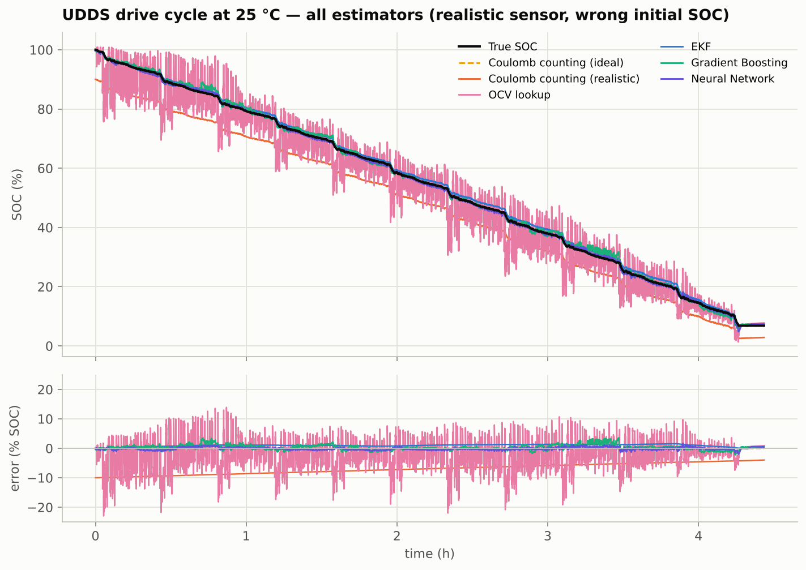
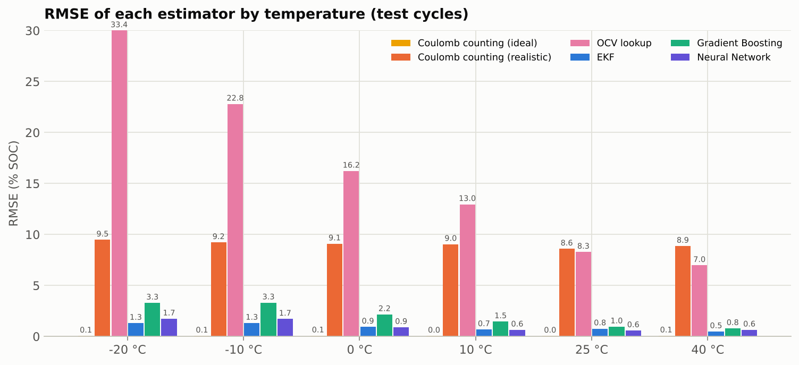
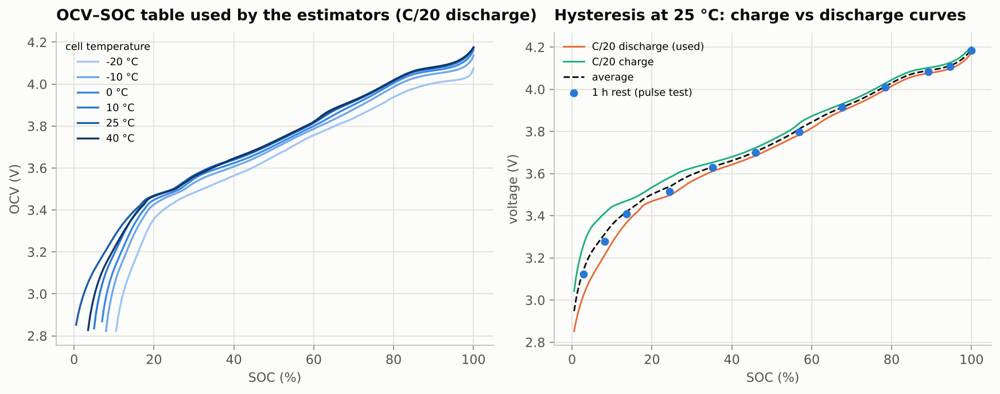
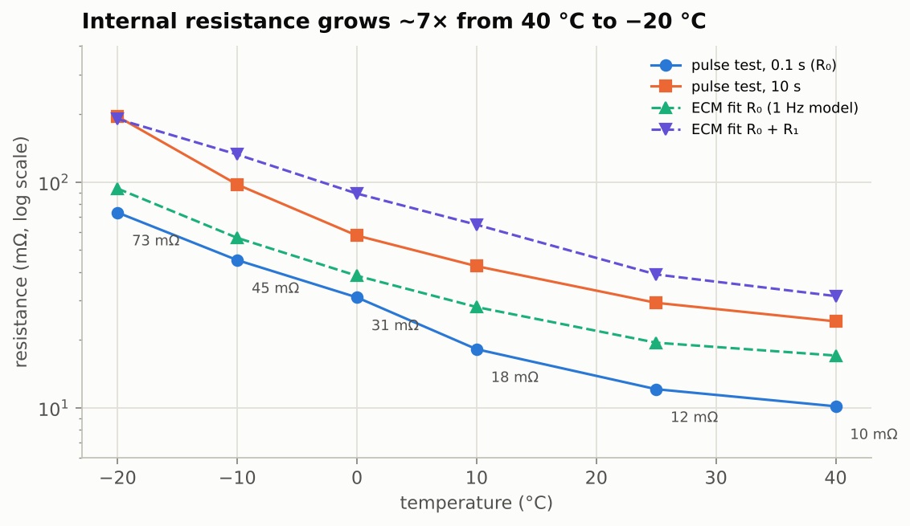
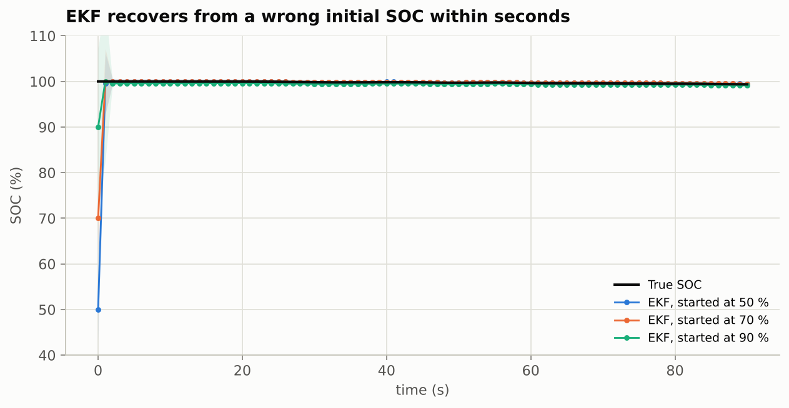

# EV Battery State-of-Charge (SOC) Estimation

**Coulomb counting, OCV lookup and an Extended Kalman Filter (Thevenin model) versus machine learning,
on a real Li-ion EV cell driven through 62 drive cycles (EPA cycles and random mixes of them) at −20 °C
to 40 °C — with a Streamlit app to watch every estimator work and to inject realistic sensor errors.**

> **In one sentence:** SOC is the fuel gauge of an electric vehicle, but unlike a fuel tank it cannot be
> measured directly — a battery management system (BMS) has to *estimate* it from voltage, current and
> temperature. This project builds the textbook estimators used in real BMSs, shows exactly where each one
> fails, and trains machine-learning estimators on the same data.

<p align="center">
  
</p>

---

## Results at a glance (22 held-out drive cycles, six temperatures)

Every estimator runs under **realistic BMS conditions**: the BMS starts believing the SOC is 10 % lower than
it really is, and its current sensor reads 2 % high with a +50 mA offset. "Worst error" is the largest
single-sample error on any test cycle after the first 15 minutes (the start-up transient).

| Estimator | What it needs | RMSE | worst error | −20 °C | 25 °C |
|---|---|---|---|---|---|
| Coulomb counting — ideal sensor, known start | perfect current sensor + initial SOC | 0.06 % | 0.3 % | 0.05 % | 0.05 % |
| Coulomb counting — realistic | — | 9.1 % | 10.6 % | 9.5 % | 8.6 % |
| OCV lookup (voltage only) | a rested cell | 17.3 % | 72.5 % | 33.4 % | 8.3 % |
| **Extended Kalman Filter** (1-RC Thevenin model) | OCV table + R₀/R₁/C₁ per temperature | **0.93 %** | **2.8 %** | **1.31 %** | 0.76 % |
| Gradient Boosting (V, I, T features) | training data | 2.07 % | 24.7 % | 3.29 % | 0.96 % |
| **Neural Network** (V, I, T features) | training data | 1.07 % | 7.1 % | 1.73 % | **0.58 %** |

* **Coulomb counting is exact in the lab and useless on its own in a car:** any current-sensor offset is
  integrated forever (+50 mA → +1.8 % SOC per hour), and a wrong starting point is never corrected.
* **The OCV lookup fails under load** — the terminal voltage sags by I·R, and in the pulse test the
  resistance at −20 °C is 7× that at 40 °C, so the "voltage gauge" is off by up to 70 % while driving.
* **The EKF fixes both weaknesses of Coulomb counting** by using the voltage as feedback: the first voltage
  sample pulls the wrong start back to within 2 %, and the filter then holds 0.63 % RMSE at 10–40 °C and
  1.3 % below 0 °C with the biased sensor. Its worst error (2.8 %) is a slow drift on the long, low-current
  UDDS cycles, where the linear cell model is least accurate.
* **The neural network is almost as accurate** (1.07 % RMSE; better than the EKF at 25 °C) and needs neither an
  initial SOC nor a current integral — but its worst error is larger (7.1 %) and it only knows the conditions
  it was trained on.

Full tables, per-cycle numbers, cell parameters and all figures: [`reports/results.md`](reports/results.md).

<p align="center">
  
</p>

---

## How it works

```
 BMS measurements, 1 Hz          estimators                                    output
 ─────────────────────          ─────────────────────────────────────────    ───────────
 V  terminal voltage    ──┬──▶  Coulomb counting   SOC = SOC₀ + ∫I dt/(3600·C)
 I  current (+ = charge)  ├──▶  OCV lookup         SOC = OCV⁻¹(V)                  SOC estimate
 T  cell temperature    ──┼──▶  EKF                predict with Coulomb counting +  (+ uncertainty
                          │                        Thevenin model, correct with V    for the EKF)
                          └──▶  ML (GB / NN)       f(V, I, T, moving averages)
```

1. **Cell characterisation** (`scripts/prepare_data.py`) — from the laboratory tests of the cell: the
   **OCV–SOC curves** at each temperature (slow C/20 discharge and charge, and the voltage after a 1 h rest at
   every SOC step of the pulse test), the **internal resistance** from the pulse test (R₀ ≈ 12 mΩ at 25 °C →
   73 mΩ at −20 °C), and the C/20 capacity that defines SOC (2.78 Ah; nominal rating 3 Ah).
2. **Equivalent-circuit model** (`src/soc/ecm.py`) — a 1-RC Thevenin model
   `V = OCV(SOC) + R₀·I + V₁`, `dV₁/dt = −V₁/(R₁C₁) + I/C₁`, with R₀, R₁, C₁ fitted by least squares on one
   training drive cycle per temperature and looked up from the measured temperature.
3. **Extended Kalman Filter** (`src/soc/ekf.py`) — state [SOC, V₁]; predict with the model, correct with the
   measured voltage; also reports its own uncertainty (±2σ band in the figures). Follows Plett (2004). The
   OCV table (C/20 discharge curve) and the noise settings were both chosen on the *training* cycles only
   (`scripts/run_experiments.py` section 1a, `scripts/tune_ekf.py`).
4. **ML estimators** (`src/soc/features.py`, `models.py`) — gradient boosting and a 64-64 neural network on 11
   causal features (V, I, T and their moving averages over 10 s – 15 min), trained on 261,003 samples from
   the 40 "Mixed" training cycles and tested on the 22 standard EPA cycles never seen in training.
5. **Evaluation** (`scripts/run_experiments.py`) — RMSE / MAE / max error per cycle and per temperature,
   settling time of the EKF, drift of Coulomb counting, all figures and `reports/results.md`.

### The physics in three figures

| | |
|---|---|
|  |  |
| *OCV–SOC tables and the charge/discharge hysteresis* | *internal resistance vs temperature (pulse test and model fit)* |

<p align="center">
  
</p>

---

## Demo app

```bash
streamlit run app/streamlit_app.py
```

Pick a temperature and a drive cycle, move the sliders for the initial-SOC error and the current-sensor
offset/gain, and watch all five estimators work through the cycle with their errors. You can also upload
your own 1 Hz log (`t_s, V, I, T`).

Command line:

```bash
python scripts/estimate.py --demo n20degC US06 --offset 0.05 --gain 1.02 --soc0-error -0.1
python scripts/estimate.py my_bms_log.csv --soc0 0.8        # your own log -> my_bms_log_soc.csv
```

---

## Quick start

```bash
git clone https://github.com/MayankGangwal-code/ev-battery-soc-estimation.git
cd ev-battery-soc-estimation
pip install -r requirements.txt

python scripts/run_experiments.py   # chooses the OCV table, fits the cell model, trains the ML estimators, evaluates, writes reports/ (~2 min)
pytest -q                           # 18 tests: estimators on a synthetic cell + data/model checks
streamlit run app/streamlit_app.py  # interactive demo
python scripts/tune_ekf.py          # optional: reproduces the EKF noise-setting grid search (~8 min)
```

The processed 1 Hz data (`data/`, 18 MB) is included, so the raw 600 MB laboratory files are only needed to
re-run `scripts/prepare_data.py` (see [`data/README.md`](data/README.md)).
Dependencies: `numpy`, `pandas`, `scipy`, `scikit-learn`, `matplotlib`, `joblib` (+ `streamlit` for the app).

---

## Data

**LG 18650HG2 Li-ion Battery Data** — Kollmeyer, Vidal, Naguib, Skells (McMaster University, 2020),
Mendeley Data, [doi:10.17632/cp3473x7xv.3](https://doi.org/10.17632/cp3473x7xv.3), CC BY 4.0.
A new 3 Ah LG HG2 cell (NMC/graphite) was tested in a thermal chamber with a 75 A / 5 V Digatron cycler:

| Test | Used for |
|---|---|
| 11–12 drive cycles per temperature (UDDS, HWFET, LA92, US06 and up to 8 random mixes), power profile of one cell in a compact EV, 10 Hz | training (mixes) and testing (EPA cycles), resampled to 1 Hz |
| HPPC pulse test at 100 → 0 % SOC | pulse resistance, rest-voltage OCV points |
| C/20 discharge / charge | capacity reference, OCV table used by the estimators, hysteresis figure |
| 1C capacity tests | cross-check of the capacity reference |

62 of the 70 drive-cycle files are used; 8 were excluded automatically (5 aborted tests with < 0.2 Ah
throughput, 1 empty file, 2 files with logger gaps of 2.6 and 6.9 minutes). **SOC ground truth** = 1 + Ah / 2.78 Ah,
where Ah is the cycler's charge counter since the full CC-CV charge. Each drive cycle was run until 95 % of
the 1C capacity *at that temperature* had been discharged; at −20 °C the 1C capacity is only 1.67 Ah (at that
rate the voltage reaches the 2.8 V limit early), so the cold cycles end at ≈ 43 % SOC with the rest of the
charge still in the cell.

---

## Project structure

```
ev-battery-soc-estimation/
├── app/streamlit_app.py          interactive demo
├── data/                         processed 1 Hz cycles, OCV tables, pulse-test results, index (+ README)
├── docs/
│   ├── interview_prep.md         2-minute pitch + 40 likely interview questions with answers
│   ├── theory.md                 Li-ion / BMS / Kalman-filter cheat-sheet
│   └── resume_bullets.md         ready-to-paste resume lines
├── models/
│   ├── cell_model.json           OCV tables + ECM parameters per temperature (the "BMS calibration")
│   └── ml_models.joblib          trained gradient boosting and neural network
├── notebooks/soc_walkthrough.ipynb   the whole analysis as one notebook
├── reports/
│   ├── results.md                auto-generated results report
│   ├── metrics.json, per_cycle_metrics.csv, ekf_tuning.csv
│   └── figures/*.png
├── scripts/
│   ├── prepare_data.py           raw cycler files -> clean 1 Hz CSVs, OCV and HPPC tables
│   ├── run_experiments.py        OCV-table choice, cell model fit, ML training, evaluation, figures, report
│   ├── tune_ekf.py               grid search of the EKF noise settings on the training cycles
│   ├── estimate.py               command-line SOC estimation for any log
│   └── make_notebook.py
├── src/soc/
│   ├── __init__.py               constants (capacity reference, temperatures, cycle names)
│   ├── coulomb.py                Coulomb counting + current-sensor error model
│   ├── ocv.py                    OCV tables (interpolation, slope, inverse, temperature set)
│   ├── ecm.py                    1-RC Thevenin model, least-squares fit, temperature table
│   ├── ekf.py                    Extended Kalman Filter
│   ├── features.py, models.py    ML estimators
│   ├── bms.py                    CellModel bundle + estimate_all() used by the app and CLI
│   └── evaluate.py, plots.py, data.py
├── tests/                        pytest suite (18 tests)
├── requirements.txt, pyproject.toml
└── LICENSE
```

---

## What I learned / limitations

* **Sensors, not algorithms, limit Coulomb counting.** With a perfect sensor it is exact; with a 50 mA
  offset it drifts 1.8 %/h. A BMS therefore needs voltage feedback (EKF) or a direct estimator (ML).
* **The OCV table must be measured in the discharge direction.** Compared on the training cycles, the
  charge curve biases the EKF by up to 19 % and the charge/discharge average by up to 4.5 % at low temperature;
  the C/20 discharge curve was the best of the four candidates and beat the pulse-test rest voltages in the
  cold, where the pulse test has few SOC steps and a 1 h rest is too short for a cold cell to relax.
* **A linear 1-RC model is good above 0 °C and marginal below.** On the −20 °C training cycle the effective
  resistance is ≈260 mΩ at 1 A but ≈123 mΩ at 6 A (Butler–Volmer non-linearity) and it also depends on SOC;
  a 2-RC model with current- and SOC-dependent parameter tables — or the neural network — is the next step.
* **Ground truth has its own uncertainty.** The reference is the cycler's Ah counter and a capacity that
  measurably fades during the campaign (the 1C capacity at 25 °C dropped 1.2 % between two tests a few days
  apart), so sub-percent differences between estimators should not be over-interpreted.
* **Not covered:** cell ageing (state of health), cell-to-cell differences in a pack, and online
  parameter adaptation — the natural next steps for a production BMS.

---

## References

* G. L. Plett, "Extended Kalman filtering for battery management systems of LiPB-based HEV battery packs —
  Parts 1–3", *Journal of Power Sources* 134 (2004). Also *Battery Management Systems, Vol. II: Equivalent-Circuit
  Methods*, Artech House, 2015.
* P. Kollmeyer, C. Vidal, M. Naguib, M. Skells, "LG 18650HG2 Li-ion Battery Data and Example Deep Neural
  Network xEV SOC Estimator Script", Mendeley Data V3, 2020.
* C. Vidal, P. Malysz, P. Kollmeyer, A. Emadi, "Machine learning applied to electrified vehicle battery
  state of charge and state of health estimation: state-of-the-art", *IEEE Access* 8 (2020).
* E. Chemali et al., "Long short-term memory networks for accurate state-of-charge estimation of Li-ion
  batteries", *IEEE Trans. Industrial Electronics* 65(8), 2018.
* M. A. Hannan et al., "A review of lithium-ion battery state of charge estimation and management system in
  electric vehicle applications", *Renewable and Sustainable Energy Reviews* 78 (2017).

---

**Author:** Mayank Gangwal — B.Tech Electrical Engineering, NSUT Delhi ·
[GitHub](https://github.com/MayankGangwal-code) · mayank.ug23@nsut.ac.in

*Licence: MIT (code). Data: CC BY 4.0, Kollmeyer et al. 2020 — please cite the dataset if you reuse it.*
