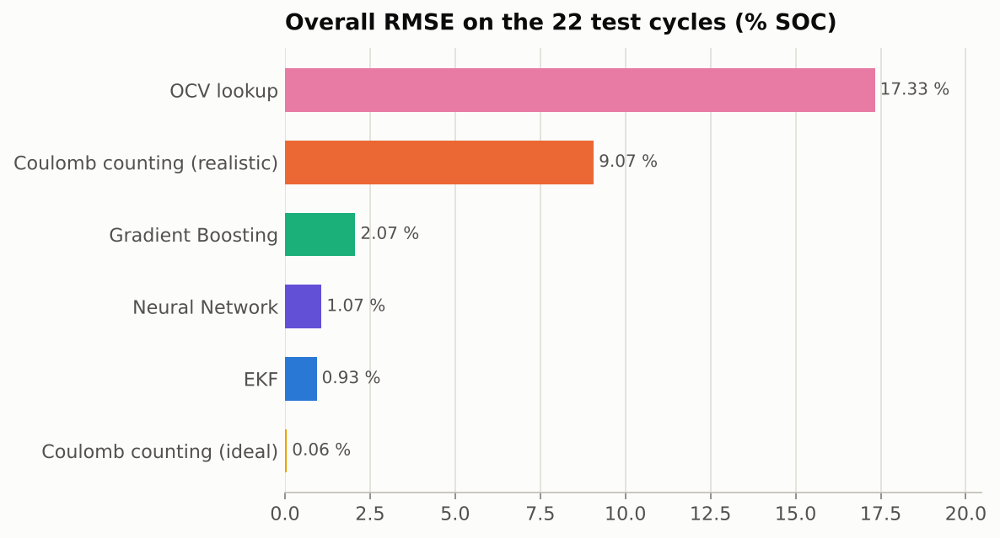
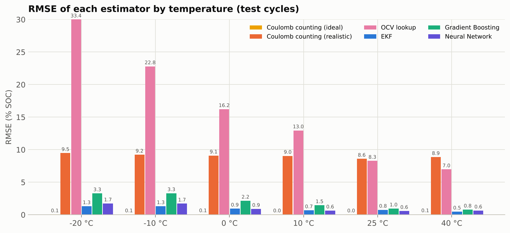
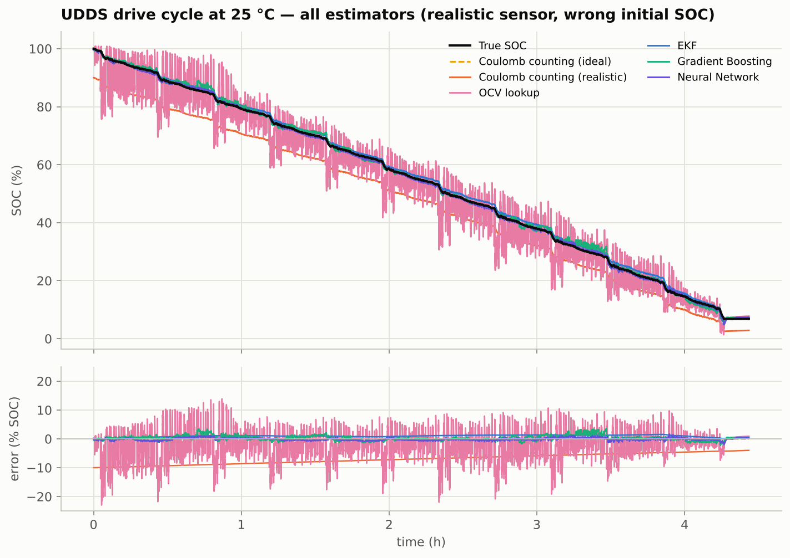
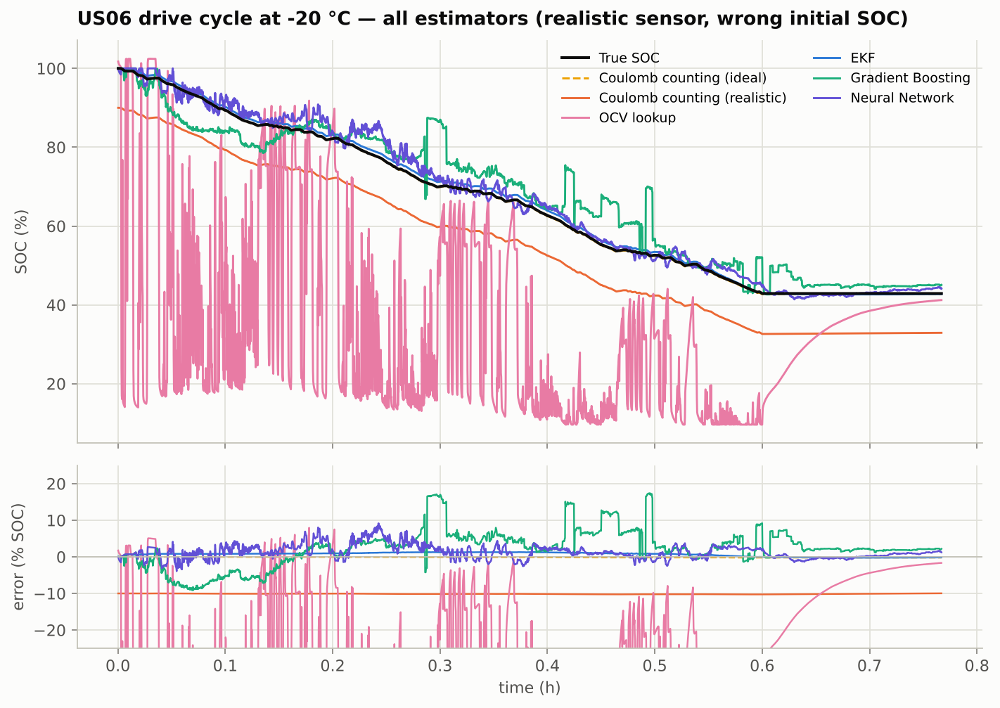
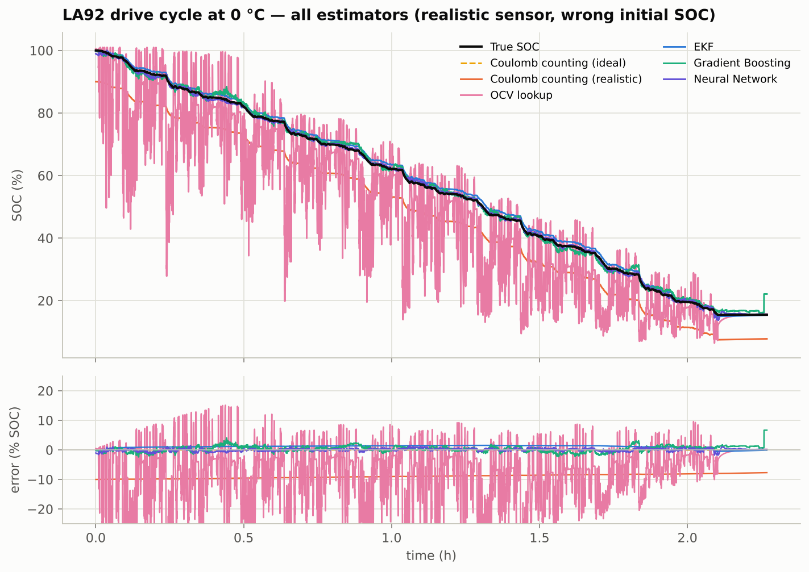
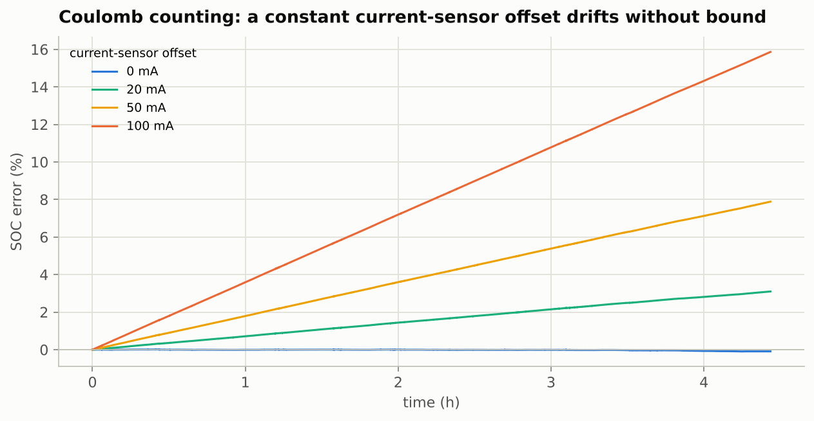
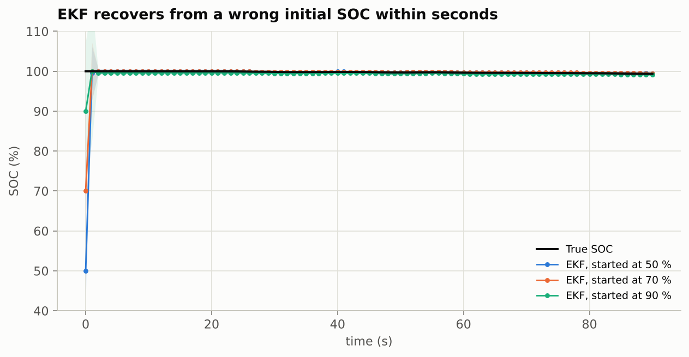
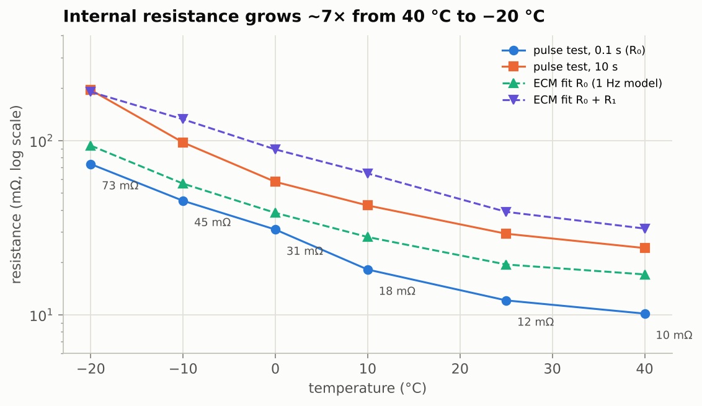
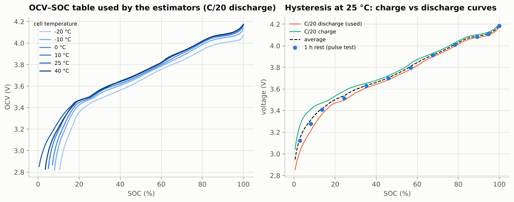
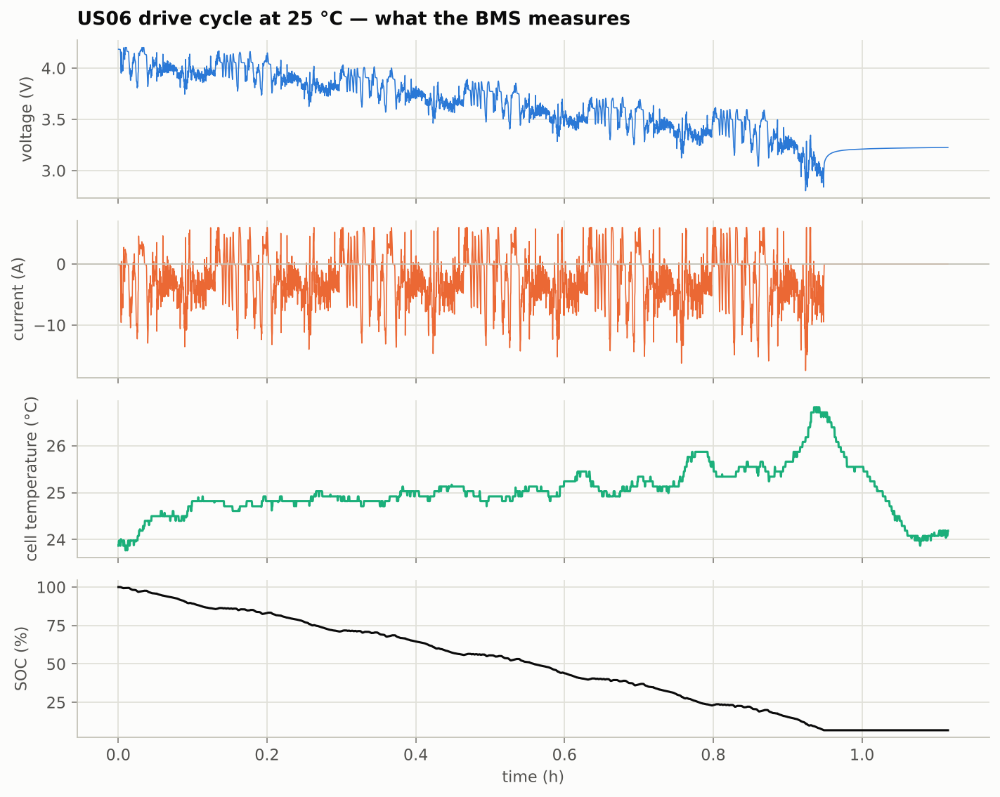

# Results

Generated by `scripts/run_experiments.py` (random_state = 42, runtime 129.7 s).

**Data.** LG 18650HG2 cell, 40 training drive cycles (random mixes) and **22 held-out
EPA drive cycles** (UDDS, HWFET, LA92, US06) at −20, −10, 0, 10, 25 and 40 °C, resampled to 1 Hz.
SOC ground truth = Ah counted by the laboratory cycler from a full charge, relative to the measured
C/20 capacity of 2.78 Ah.

**Realistic BMS conditions** (applied to every estimator except the "ideal" Coulomb counter): the BMS
starts believing the SOC is **10 % lower** than it is, and the current sensor reads **2 % high with a
+50 mA offset**.

## 1. Overall accuracy on the 22 test cycles

"After 15 min" columns ignore the first 15 minutes of each cycle, i.e. the start-up transient of the
estimators that begin with the wrong initial SOC.

| Estimator | RMSE (%) | MAE (%) | RMSE after 15 min (%) | mean per-cycle max |error| after 15 min (%) | worst error after 15 min (%) |
|---|---|---|---|---|---|
| Coulomb counting (ideal) | 0.06 | 0.05 | 0.06 | 0.10 | 0.27 |
| Coulomb counting (realistic) | 9.07 | 9.02 | 8.99 | 9.94 | 10.57 |
| OCV lookup | 17.33 | 13.80 | 15.94 | 46.01 | 72.51 |
| EKF | 0.93 | 0.84 | 0.96 | 1.50 | 2.80 |
| Gradient Boosting | 2.07 | 1.57 | 2.04 | 6.90 | 24.73 |
| Neural Network | 1.07 | 0.83 | 0.87 | 2.93 | 7.14 |

* Ideal Coulomb counting is essentially exact — the problem is never the method, it is the sensor and
  the unknown starting point: with realistic errors the same integral drifts to a mean RMSE of
  9.1 %.
* Reading SOC off the OCV curve from the terminal voltage alone fails under load (voltage sag), with
  the error exploding at low temperature where the internal resistance is largest.
* The **EKF** (equivalent-circuit model + Kalman filter) uses the voltage to *correct* Coulomb counting.
  From the 10 % wrong start the estimate is back inside ±2 % of the truth (and stays there for at least a
  minute) within 1 s on every test cycle: each cycle starts from a fully charged cell, where the OCV
  curve is steep and a single voltage reading is very informative. At 10–40 °C the filter then holds an
  RMSE of 0.63 % despite the biased current sensor, with a worst error of 1.6 % after the first
  15 min (the slow drift on the long, low-current UDDS cycles). Below 0 °C the linear 1-RC model describes the cell less well — on the −20 °C
  training cycle the effective resistance (OCV − V)/|I| is ≈260 mΩ at 1 A but only ≈123 mΩ at 6 A, a
  non-linearity a fixed R₀ cannot capture — and the per-cycle RMSE is 0.5–2.1 %
  (worst error 2.8 % after the first 15 min).
* The **ML estimators** need neither an initial SOC nor a current integral; the neural network reaches
  1.07 % RMSE and gradient boosting 2.07 %.

## 2. RMSE by temperature (mean over the test cycles at each temperature, % SOC)

| Estimator | -20 °C | -10 °C | 0 °C | 10 °C | 25 °C | 40 °C |
|---|---|---|---|---|---|---|
| Coulomb counting (ideal) | 0.05 | 0.05 | 0.07 | 0.05 | 0.05 | 0.07 |
| Coulomb counting (realistic) | 9.48 | 9.22 | 9.09 | 9.05 | 8.59 | 8.86 |
| OCV lookup | 33.38 | 22.80 | 16.23 | 12.96 | 8.28 | 6.97 |
| EKF | 1.31 | 1.31 | 0.94 | 0.68 | 0.76 | 0.48 |
| Gradient Boosting | 3.29 | 3.31 | 2.16 | 1.46 | 0.96 | 0.79 |
| Neural Network | 1.73 | 1.71 | 0.90 | 0.65 | 0.58 | 0.65 |

## 3. What the estimators do over a drive cycle

### Coulomb counting drifts with any current offset

### The EKF recovers from a wrong initial SOC (UDDS at 25 °C, shaded = ±2σ of the filter's own uncertainty)

## 4. Cell characterisation used by the model-based estimators

### Equivalent-circuit parameters (1-RC Thevenin model, fitted on the Mixed1 cycle at each temperature)

|  | -20 °C | -10 °C | 0 °C | 10 °C | 25 °C | 40 °C |
|---|---|---|---|---|---|---|
| R0 (mΩ) | 93.5 | 56.6 | 38.4 | 27.9 | 19.4 | 17.0 |
| R1 (mΩ) | 96.7 | 75.9 | 50.5 | 36.8 | 19.5 | 14.2 |
| τ = R1C1 (s) | 38.9 | 59.1 | 53.5 | 45.5 | 26.5 | 21.5 |
| fit RMS (mV) | 85.6 | 62.1 | 31.6 | 17.1 | 12.8 | 10.1 |
| pulse-test R0 (mΩ) | 73.2 | 45.1 | 30.8 | 18.2 | 12.1 | 10.1 |

### OCV–SOC tables — which curve should the BMS store?

A Li-ion cell shows hysteresis: at the same SOC the OCV measured while charging is higher than while
discharging (right panel of the figure). Four candidate tables were compared on the 34 training
cycles (EKF, same realistic conditions, ECM refitted for each table); the best one — **C/20 discharge** — is
the table used everywhere else in this report.

| OCV table (RMSE % on training cycles) | mean RMSE (%) | -20 °C | -10 °C | 0 °C | 10 °C | 25 °C | 40 °C |
|---|---|---|---|---|---|---|---|
| pulse-test rest voltage | 2.74 | 7.53 | 2.61 | 1.83 | 1.56 | 0.50 | 0.42 |
| C/20 discharge | 1.05 | 1.99 | 1.56 | 0.81 | 0.51 | 0.48 | 0.58 |
| C/20 charge | 6.23 | 20.70 | 4.24 | 2.55 | 1.06 | 2.39 | 1.53 |
| C/20 average | 2.53 | 6.77 | 2.46 | 1.70 | 1.32 | 0.63 | 0.61 |

Mean signed EKF error after 15 min (% SOC), training cycles — a wrong curve shows up as a bias:

| OCV table | -20 °C | -10 °C | 0 °C | 10 °C | 25 °C | 40 °C |
|---|---|---|---|---|---|---|
| pulse-test rest voltage | -6.42 | -1.69 | -1.31 | -1.21 | -0.05 | 0.22 |
| C/20 discharge | 0.35 | 1.32 | 0.32 | 0.28 | 0.43 | 0.57 |
| C/20 charge | -19.20 | -2.07 | -1.08 | -0.23 | -1.55 | -1.23 |
| C/20 average | -4.53 | 1.67 | -0.24 | -0.59 | 0.02 | -0.20 |

The charge curve and the charge/discharge average both bias the filter (the cell is almost always
discharging while driving). The pulse-test rest voltages and the C/20 discharge curve agree within
≈10–20 mV above 35 % SOC and give similar results at 25–40 °C; the C/20 curve wins clearly at low
temperature, most likely because the cold pulse test has few SOC steps (9 at −20 °C versus 180 points
on the C/20 curve) and a 1 h rest is not long enough for a cold cell to reach equilibrium.

## 5. Per-cycle RMSE (% SOC)

| Test cycle | Coulomb counting (realistic) | EKF | Gradient Boosting | Neural Network |
|---|---|---|---|---|
| -20 °C, HWFET | 9.83 | 1.03 | 3.15 | 2.31 |
| -20 °C, LA92 | 9.36 | 2.08 | 1.83 | 0.91 |
| -20 °C, UDDS | 8.58 | 1.27 | 2.60 | 1.37 |
| -20 °C, US06 | 10.13 | 0.85 | 5.59 | 2.33 |
| -10 °C, HWFET | 9.73 | 0.48 | 2.69 | 1.93 |
| -10 °C, LA92 | 9.05 | 2.04 | 1.51 | 0.84 |
| -10 °C, UDDS | 7.92 | 1.90 | 3.05 | 1.11 |
| -10 °C, US06 | 10.18 | 0.83 | 5.99 | 2.96 |
| 0 °C, HWFET | 9.68 | 0.39 | 1.71 | 1.04 |
| 0 °C, LA92 | 8.94 | 1.18 | 1.08 | 0.46 |
| 0 °C, UDDS | 7.49 | 1.75 | 2.36 | 0.67 |
| 0 °C, US06 | 10.27 | 0.41 | 3.49 | 1.44 |
| 10 °C, HWFET | 9.63 | 0.30 | 1.00 | 0.44 |
| 10 °C, UDDS | 7.35 | 1.22 | 1.34 | 0.55 |
| 10 °C, US06 | 10.17 | 0.52 | 2.03 | 0.95 |
| 25 °C, LA92 | 8.54 | 0.94 | 0.65 | 0.47 |
| 25 °C, UDDS | 7.17 | 1.04 | 0.88 | 0.45 |
| 25 °C, US06 | 10.07 | 0.31 | 1.34 | 0.81 |
| 40 °C, HWFET | 9.57 | 0.23 | 0.66 | 0.42 |
| 40 °C, LA92 | 8.58 | 0.64 | 0.52 | 0.50 |
| 40 °C, UDDS | 7.24 | 0.85 | 0.95 | 0.76 |
| 40 °C, US06 | 10.07 | 0.20 | 1.03 | 0.91 |

## 6. What the BMS sees

